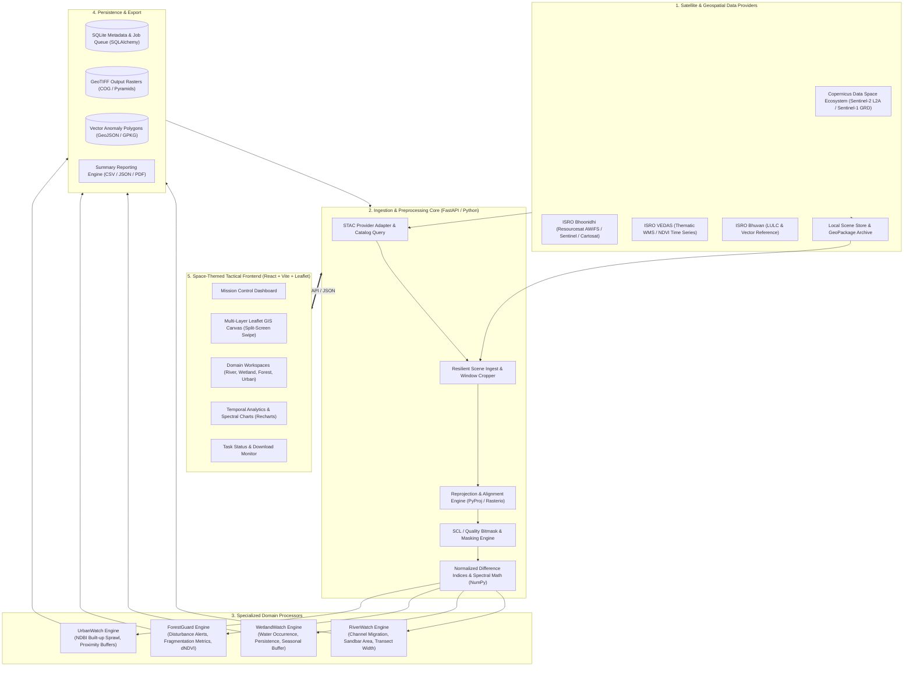

# SYSTEM ARCHITECTURE — TERRAWATCH 360

## Layer Separation and Boundaries
1. **Frontend**: Vite + React 18 + TypeScript + Tailwind CSS. Strictly presentation, client-side map interactions (AOI drawing via Leaflet Draw, layer toggling, swipe slider), and metric visualization. No raw API keys or heavy matrix manipulation on the browser.
2. **Backend Gateway**: FastAPI with async route handlers, background tasks for long-running raster computations, and clean Pydantic request/response validation.
3. **Geospatial Pipeline**: Python-based Rasterio, Shapely, PyProj, and NumPy. Vector geometries are maintained in EPSG:4326 for interchange and projected to local UTM (e.g., UTM Zone 43N/44N/45N) for area calculations.
4. **Resilience Strategy**: Fallback mock/sample provider for offline mode; live STAC client when online credentials/network are available.
