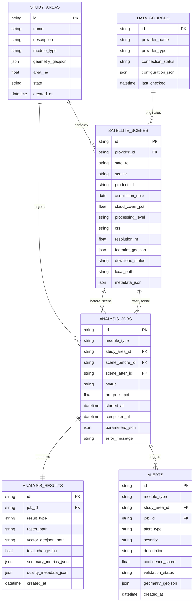

# DATABASE SCHEMA SPECIFICATION — TERRAWATCH 360

The application uses SQLite as its default zero-configuration relational engine, structured with a clean data-access layer that can transparently scale to PostgreSQL / PostGIS.

---

### Entity-Relationship Diagram

---

### Key Tables & Constraints
1. **study_areas**: Stores standard pre-configured Indian study zones (Yamuna Delhi stretch, Deepor Beel, Silent Valley, Bengaluru peri-urban) plus user-drawn polygons. Geometries are GeoJSON Feature collections.
2. **satellite_scenes**: Catalogs actual scenes discovered via STAC or bundled offline datasets.
3. **analysis_jobs**: Tracks async job states: `PENDING`, `RUNNING`, `COMPLETED`, `FAILED`.
4. **analysis_results**: References disk-persisted GeoTIFFs, vector GeoJSON polygons, and quantified surface metrics (hectares, width variances).
5. **alerts**: Stores actionable change flags with scientific cautionary categories (`POTENTIAL_DISTURBANCE`, `UNUSUAL_RIVERBED_CHANGE`, `SEASONAL_WATER_VARIATION`).
