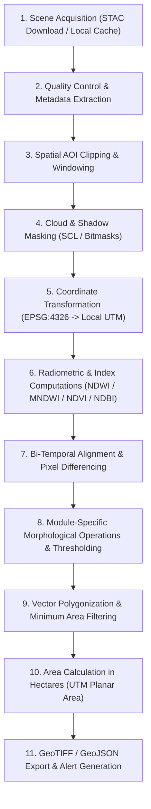

# SHARED GEOSPATIAL PROCESSING PIPELINE

All four environmental modules share a robust, mathematically rigorous geospatial pipeline.

---

## Pipeline Stages

### 1. Ingestion & Quality Control
- Optical scenes must possess valid metadata: sun elevation, cloud cover percentage, acquisition timestamp, and sensor type.
- Sentinel-2 Level-2A surface reflectance is scaled (digital numbers divided by 10,000) to obtain physical surface reflectance [0.0, 1.0].

### 2. Cloud and Shadow Masking
- Using Sentinel-2 Scene Classification Layer (SCL):
  - Values 3 (Cloud Shadows), 8 (Cloud Medium Probability), 9 (Cloud High Probability), 10 (Thin Cirrus) are masked as NoData.
  - Valid pixel percentage is calculated and attached to analysis results. If valid pixels < 60%, a quality warning is logged.

### 3. Spatial Reference & Metric Projections
- Geographic WGS84 (EPSG:4326) is strictly reserved for storage, cataloging, and Leaflet GeoJSON display.
- All spatial distance measurements (transect width) and area aggregations (hectares) are evaluated after projecting rasters into the appropriate Indian UTM Zone (e.g., EPSG:32643 for Zone 43N, EPSG:32644 for Zone 44N).
- Pixel area formula: `Area (ha) = (Pixel_Count * Resolution_X_meters * Resolution_Y_meters) / 10,000`.

### 4. Vectorization & Polygonization
- Binary change masks undergo morphological opening/closing (using 3x3 structuring elements) to eliminate single-pixel noise.
- Connected component analysis clusters contiguous changed pixels into discrete polygons.
- Small noise polygons below threshold (e.g., < 0.25 ha) are removed.
