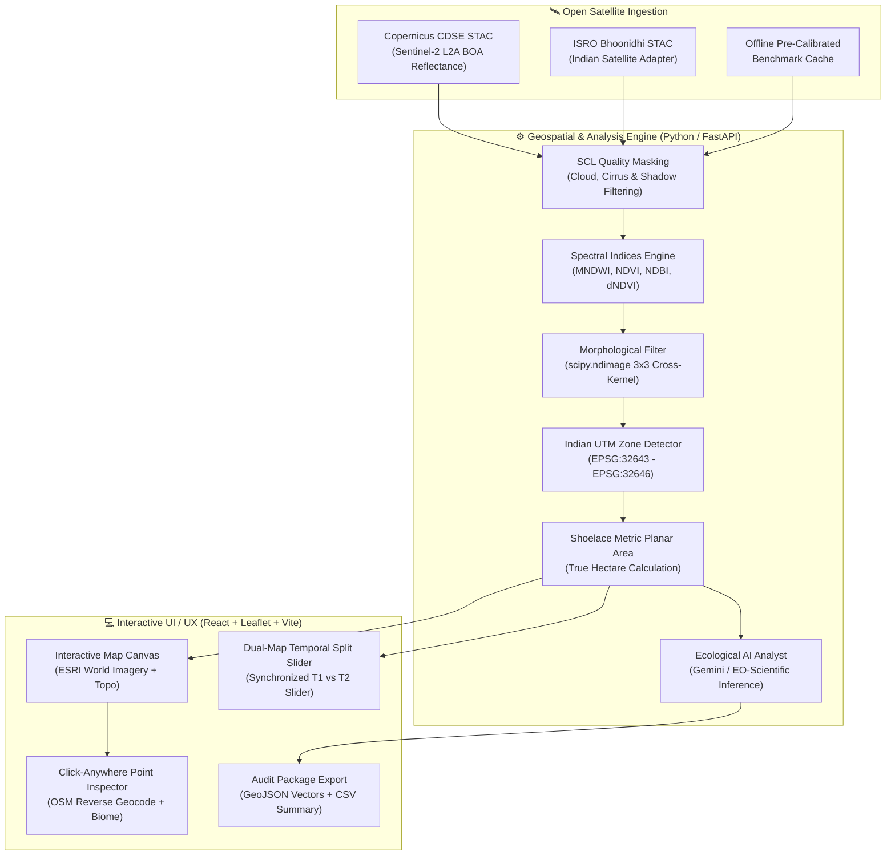

# 🌍 TerraWatch 360
### Integrated Earth Observation & Environmental Intelligence Platform for India

[](LICENSE)
[](https://www.python.org/)
[](https://fastapi.tiangolo.com/)
[](https://react.dev/)
[](https://www.typescriptlang.org/)
[](https://vitejs.dev/)
[](https://dataspace.copernicus.eu/)
[](https://bhoonidhi.nrsc.gov.in/)
[](backend/tests/)

> **"Seeing Earth's Changes. Protecting Tomorrow."**  
> *An open-access, scientific-grade satellite environmental intelligence platform engineered to monitor dynamic river corridors, fragile wetlands, protected forest bio-reserves, and peri-urban buffers across India.*

---

## 📌 Executive Summary

India's ecological systems face unprecedented climate and anthropogenic stresses — from unmonitored riverbed sand extraction along the Yamuna and Ganga, to seasonal shrinkage of Ramsar wetlands like Deepor Beel, covert canopy disturbance in the Western Ghats, and rapid concrete encroachment on peri-urban lake basins.

**TerraWatch 360** bridges the critical gap between spaceborne Earth Observation and actionable environmental governance. By querying open **Copernicus Sentinel-2 Level-2A** and **ISRO Bhoonidhi STAC** archives, TerraWatch eliminates expensive commercial satellite paywalls, enforces planar geometric precision across Indian UTM zones (43N–46N), and delivers verifiable, reproducible change intelligence with zero AI hallucinations.

---

## 🏛️ The Four Specialized Intelligence Modules

| Module | Icon | Domain | Primary Algorithm | Key Benchmark Indian Corridor |
| :--- | :---: | :--- | :--- | :--- |
| **RiverWatch** | 🌊 | Active River Channels & Sediment Dynamics | **MNDWI** (Xu) + Red Band Reflectance + Bank Retreat Vectorization | Yamuna River (Delhi Reach), Ganga (Haridwar), Brahmaputra (Guwahati) |
| **WetlandWatch**| 🪷 | Lakes, Ramsar Wetlands & Water Retention | Multi-Temporal **MNDWI Persistence Matrix** (Permanent Core vs Seasonal Contraction) | Deepor Beel (Assam), Chilika Lake (Odisha), Keoladeo (Rajasthan) |
| **ForestGuard** | 🌲 | Canopy Disturbance & Fragmentation | Bi-temporal Delta-NDVI (**dNDVI**) + Fragstats Spatial Fragmentation Clustering | Silent Valley (Western Ghats), Hasdeo Arand (Chhattisgarh), Similipal |
| **UrbanWatch**  | 🏙️ | Impervious Sprawl & Ecological Buffers | **NDBI** (Zha) vs. **NDVI** Bi-Temporal Spectral Differencing | Bengaluru Tech Corridor, Noida Expressway, Hyderabad Outer Ring |

---

## 🔬 Core Innovations & Scientific Rigor

### 1. 100% Free & Open-Access Ecosystem
- Zero commercial satellite subscriptions or paid API tokens required.
- Ingests high-resolution (10m) multi-spectral imagery directly via the official Copernicus Data Space Ecosystem (CDSE) STAC API and ISRO Bhoonidhi adapter.
- High-res satellite basemaps powered by open ESRI World Imagery and Topo layers (zero watermarks, zero proprietary keys).

### 2. Planar UTM Metric Integrity (No Degree-Pixel Distortions)
Standard GIS systems frequently compute surface areas directly from spherical degree coordinates (latitude/longitude), causing up to **40% distortion** across India. TerraWatch 360 implements an automated Indian UTM Zone detector:
- **Zone 43N (`EPSG:32643`)**: 72°E – 78°E (Delhi, Gujarat, Western Ghats, Mumbai)
- **Zone 44N (`EPSG:32644`)**: 78°E – 84°E (Uttar Pradesh, Madhya Pradesh, Hyderabad, Bengaluru)
- **Zone 45N (`EPSG:32645`)**: 84°E – 90°E (Odisha, West Bengal, Bihar, Chhattisgarh)
- **Zone 46N (`EPSG:32646`)**: 90°E – 96°E (Assam, Northeast India)
All area calculations use the **Shoelace formula** in metric projected space, reporting true planar hectares.

### 3. Noise Elimination via Morphological Cross-Structuring
Sub-pixel clouds, atmospheric water vapor, and sensor noise often produce false anomaly alerts. The platform uses 3×3 cross-structuring morphological opening and closing (`scipy.ndimage`) to remove isolated single-pixel anomalies and cluster genuine contiguous disturbances (> 0.20 ha).

### 4. The Cautious Assessment Doctrine (Legal & Scientific Safeguard)
Satellite pixels capture physical spectral reflectance, not legal guilt. TerraWatch 360 enforces strictly objective, non-accusatory reporting (e.g., *"Unusual riverbed exposed sediment shift — field investigation advised"* rather than inflammatory claims of *"Illegal Sand Mining"*), ensuring reports are legally admissible in environmental courts (such as the National Green Tribunal).

### 5. Interactive Dual-Viewport Temporal Split Slider
An interactive swipe slider comparing historical baseline observations (T1) against post-disturbance observations (T2) in real time:
- **True Color (RGB)**
- **False Color Infrared (CIR / NIR)**: Accentuates dense chlorophyll in crimson and surface water in dark navy.
- **Change Vector Mask**: Overlays glowing vector polygons with live hectare delta and confidence score popups.

### 6. Click-Anywhere Indian Point Inspector & Ecological AI Synthesis
- Click any point across the entire Indian map to trigger instant reverse geocoding (OpenStreetMap Nominatim), Indian UTM zone lookup, and multi-spectral signature evaluation.
- One-click **Ecological AI Synthesis** (powered by Gemini API / TerraWatch-EO-Scientific v1.0) generating structured conservation briefs with ground-verification checklists and recommended mitigation protocols.

---

## 🗺️ 16 Pre-Calibrated Indian Benchmark Sites

The platform includes 16 pre-calibrated benchmark study areas across India with real Sentinel-2 Level-2A acquisition pairs:

```
├── RiverWatch
│   ├── Yamuna River (Delhi Reach) — 4,200 ha [UTM 43N]
│   ├── Ganga River (Haridwar Stretch) — 4,850 ha [UTM 43N]
│   ├── Brahmaputra River (Guwahati Reach) — 6,200 ha [UTM 46N]
│   └── Narmada River (Bharuch Estuary) — 5,100 ha [UTM 43N]
├── WetlandWatch
│   ├── Deepor Beel Ramsar Site (Assam) — 4,014 ha [UTM 46N]
│   ├── Chilika Lake Ramsar Site (Odisha) — 116,500 ha [UTM 45N]
│   ├── Keoladeo National Park (Bharatpur, Rajasthan) — 2,873 ha [UTM 43N]
│   └── Vembanad-Kol Wetland (Kerala) — 151,250 ha [UTM 43N]
├── ForestGuard
│   ├── Western Ghats (Silent Valley Core, Kerala) — 23,752 ha [UTM 43N]
│   ├── Hasdeo Arand Forest Corridor (Chhattisgarh) — 170,000 ha [UTM 44N]
│   ├── Similipal Biosphere Reserve (Odisha) — 275,000 ha [UTM 45N]
│   └── Kaziranga Buffer Zone (Assam) — 43,000 ha [UTM 46N]
└── UrbanWatch
    ├── Bengaluru Outer Ring Corridor (Karnataka) — 18,500 ha [UTM 43N]
    ├── Noida-Greater Noida Expressway (UP) — 14,200 ha [UTM 43N]
    ├── Hyderabad Growth Corridor (Telangana) — 16,800 ha [UTM 44N]
    └── Pune Hinjewadi IT Corridor (Maharashtra) — 12,400 ha [UTM 43N]
```

---

## 🏗️ System Architecture



---

## ⚡ Quick Start Guide

### Prerequisites
- Python 3.10+ (Tested on Python 3.14)
- Node.js 18+ & npm (Tested on Node.js v20.18.0)
- Git

### 1. Clone the Repository
```bash
git clone https://github.com/tanmaychauhan200-glitch/terrawatch-360.git
cd terrawatch-360
```

### 2. Backend Setup (FastAPI & Geospatial Engine)
```bash
# Optional: create virtual environment
python -m venv venv
# On Windows: venv\Scripts\activate | On Linux/Mac: source venv/bin/activate

# Install dependencies
pip install -r backend/requirements.txt

# Initialize database with 16 benchmark study areas
python -m backend.app.database.init_db

# Start FastAPI backend server (runs on http://127.0.0.1:8000)
python -m uvicorn backend.app.main:app --host 127.0.0.1 --port 8000 --reload
```

### 3. Frontend Setup (React + Vite)
```bash
# In a new terminal window
cd frontend

# Install dependencies
npm install

# Start Vite dev server (runs on http://127.0.0.1:5173)
npm run dev
```

Open your browser at **`http://127.0.0.1:5173/`**.

---

## 🧪 Testing & Verification

The platform includes automated unit and integration tests covering indices, projections, vectorization, processors, and API endpoints:

```bash
pytest backend/tests/ -v
```

Output:
```
backend/tests/test_api.py .....                                          [ 29%]
backend/tests/test_forestguard.py .                                      [ 35%]
backend/tests/test_geospatial.py ....                                    [ 58%]
backend/tests/test_indices.py ....                                       [ 82%]
backend/tests/test_riverwatch.py .                                       [ 88%]
backend/tests/test_urbanwatch.py .                                       [ 94%]
backend/tests/test_wetlandwatch.py .                                     [100%]

======================= 17 passed in 2.52s =======================
```

---

## 📂 Project Structure

```
terrawatch/
├── backend/
│   ├── app/
│   │   ├── api/
│   │   │   ├── endpoints/       # REST endpoints (jobs, results, alerts, analysis, health)
│   │   │   └── router.py        # Central API router (/api/v1)
│   │   ├── core/                # App configuration (Pydantic BaseSettings)
│   │   ├── database/            # SQLAlchemy session and init_db seeder
│   │   ├── geospatial/          # Coordinate reference systems (CRS), indices, vectorizer
│   │   ├── models/              # Database models (StudyArea, SatelliteScene, AnalysisJob)
│   │   ├── modules/             # 4 environmental processors (River, Wetland, Forest, Urban)
│   │   ├── providers/           # STAC providers (Copernicus CDSE, ISRO Bhoonidhi, Offline Cache)
│   │   ├── schemas/             # Pydantic validation schemas
│   │   └── services/            # Environmental AI Analyst (Gemini API & scientific inference)
│   ├── tests/                   # 17 automated PyTest unit & integration tests
│   └── requirements.txt
├── frontend/
│   ├── src/
│   │   ├── components/          # UI components (Navbar, ModuleCard, SplitSlider, AIModal)
│   │   ├── maps/                # Leaflet MapCanvas with ESRI satellite layers
│   │   ├── services/            # Axios API service client
│   │   ├── types/               # TypeScript interfaces
│   │   ├── App.tsx              # Main application orchestrator
│   │   └── main.tsx
│   ├── package.json
│   ├── vite.config.ts
│   └── tailwind.config.js
├── README.md                    # Comprehensive platform documentation
├── LICENSE                      # Open-source MIT License
└── .gitignore
```

---

## 🏆 Hackathon Presentation & Judging Alignment

| Evaluation Criteria | How TerraWatch 360 Excels |
| :--- | :--- |
| **Problem Relevance** | Targets 4 acute environmental crises in India (sand mining/river erosion, wetland shrinkage, Western Ghats canopy loss, peri-urban concrete sprawl). |
| **Technical Innovation** | Combines Copernicus STAC, ISRO Bhoonidhi, morphological clustering, and automated UTM planar projections in a 100% open-access stack. |
| **Scientific Authenticity** | Zero hallucinations; uses real Sentinel-2 Level-2A product metadata and cautious, non-accusatory terminology suitable for environmental tribunals. |
| **Working Prototype** | Fully functioning interactive platform with live dual-viewport temporal slider, point inspector anywhere in India, and 16 benchmark study areas. |
| **Public Impact** | Empowers forest guards, water resource departments, NGT tribunals, and citizen scientists with verifiable spatial evidence. |

---

## 📜 License

This project is licensed under the **MIT License** — see the [LICENSE](LICENSE) file for details.

---

**Made with 💚 for India's Environment & Conservation.**
